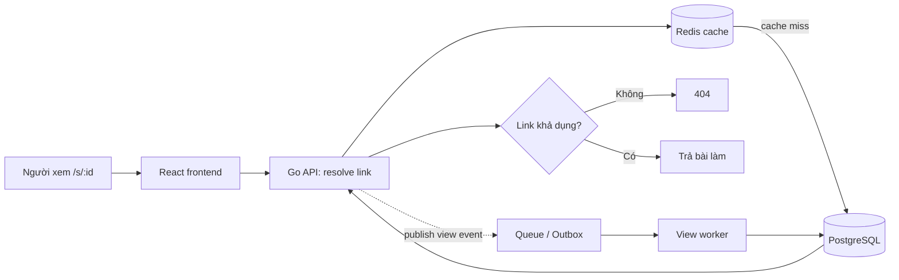
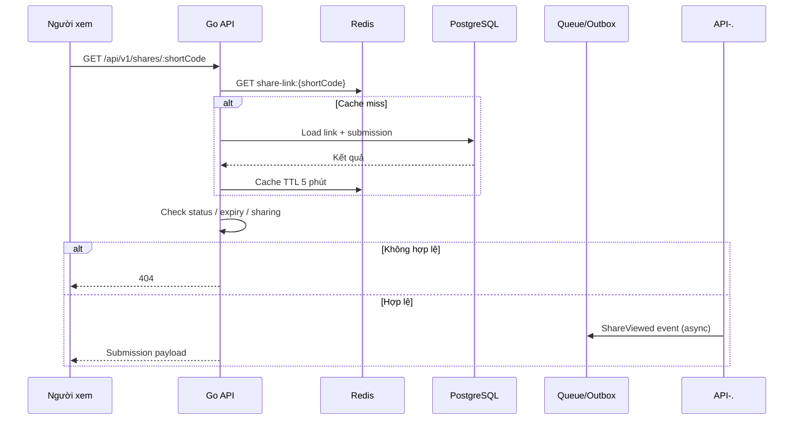
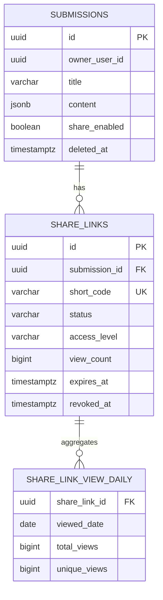

# Shortbit

Shortbit là dịch vụ URL shortener dành cho tính năng chia sẻ bài làm của YouPass. Mục tiêu là cung cấp link ngắn dạng `https://youpass.vn/s/:id`, phản hồi nhanh, có thể vô hiệu hóa ngay khi học sinh tắt chia sẻ, và ghi nhận lượt xem mà không làm chậm request đọc.

## Phạm vi bản khởi tạo

Repository này mới là backend foundation để review kiến trúc trước khi triển khai đầy đủ. Đã có:

- HTTP API Gin với endpoint health check và resolve link public.
- Domain model, PostgreSQL migration và repository cho `Submission` / `ShareLink`.
- Redis read-through cache; Redis lỗi không làm link hợp lệ bị lỗi.
- Kiểm tra link revoked, hết hạn, bài làm bị xóa và cờ `share_enabled`.
- Sinh short code URL-safe bằng `crypto/rand`.
- Ranh giới service sẵn sàng thay phần ghi view trực tiếp bằng event/outbox worker.

Chưa triển khai ở bản này: authentication/ownership, tạo và revoke link qua API, worker/outbox đếm view, rate limiting, migration runner và frontend React. Đây là các hạng mục tiếp theo để cùng review trước khi code chi tiết.

## Kiến trúc



`share_links` là thực thể đại diện cho quyền chia sẻ, tách khỏi bài làm. Một request resolve chỉ thành công khi link `active`, chưa bị revoke, chưa hết hạn; đồng thời bài làm chưa bị xóa và `share_enabled = true`.

## Flow resolve URL



API dùng `404` cả khi link không tồn tại lẫn khi đã bị vô hiệu nhằm hạn chế dò link. Khi người sở hữu revoke link hoặc tắt share, transaction cập nhật DB phải xóa cache key `share-link:{shortCode}` ngay sau commit.

## Database schema



| Bảng | Vai trò |
|---|---|
| `submissions` | Bài làm và cờ chia sẻ tổng ở cấp bài làm. |
| `share_links` | Mapping mã ngắn sang bài làm, trạng thái vòng đời, quyền truy cập và counter tổng hợp. |
| `share_link_view_daily` | Thống kê lượt xem theo ngày, phù hợp cho dashboard. |

Khi cần analytics/audit chi tiết, sẽ bổ sung `share_link_view_events` có partition theo thời gian hoặc đưa event sang kho analytics. Không ghi event đồng bộ trên đường hot path.

## Định hướng về performance và bảo mật

- `short_code` có unique index; lookup là truy vấn điểm.
- Mã link không tuần tự, tối thiểu 72-bit entropy trong implementation hiện tại.
- Redis cache TTL ngắn, invalidation chủ động khi revoke/thay đổi quyền.
- View sẽ được ghi qua transactional outbox hoặc queue, worker batch increment `view_count` và upsert aggregate theo ngày.
- Endpoint public sẽ có IP-based rate limit và bot policy trước khi production.
- `access_level` đã có trong schema: `public`, `authenticated`, `restricted`; enforcement chi tiết sẽ được thêm cùng module identity của YouPass.

## Cấu trúc code

```text
cmd/api/                       entry point HTTP server
internal/config/               biến môi trường
internal/platform/             PostgreSQL và Redis adapters
internal/share/domain/         domain entities và business invariant
internal/share/repository/     persistence adapter
internal/share/service/        use case resolve link
internal/share/transport/http/ Gin router + handler
migrations/                    PostgreSQL DDL
```

Structure tham chiếu cách tổ chức từ `go-base-project`; dependency local `go-base-utils` được khai báo qua `replace` để có thể dùng các helper như HTTP middleware, rate limit, cache, logging, transaction/outbox khi bước implementation bắt đầu.

## Chạy local

Yêu cầu: Go 1.22.7+, PostgreSQL và Redis.

```bash
cp config/local.env.example .env
set -a; source .env; set +a
go mod tidy
go run ./cmd/api
```

Sau đó kiểm tra:

```bash
curl -i http://localhost:8080/healthz
```

## API hiện có

```http
GET /healthz
GET /api/v1/shares/:shortCode
```

Response của resolve link chỉ trả bài làm nếu link và bài làm cùng khả dụng. Các endpoint dự kiến ở bước tiếp theo:

```http
POST  /api/v1/submissions/:submissionId/share-links
PATCH /api/v1/share-links/:shareLinkId
DELETE /api/v1/share-links/:shareLinkId
GET    /api/v1/share-links/:shareLinkId/analytics
```

## Kế hoạch implementation tiếp theo

1. Chốt contract với YouPass identity/submission service, cách lấy ownership và payload bài làm.
2. Thêm create/revoke API, authorization middleware và Redis invalidation sau commit.
3. Thêm transactional outbox + worker ghi view theo batch, rồi dashboard analytics.
4. Thêm test repository/service, observability, rate limit và React share page.
