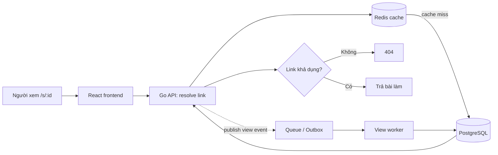
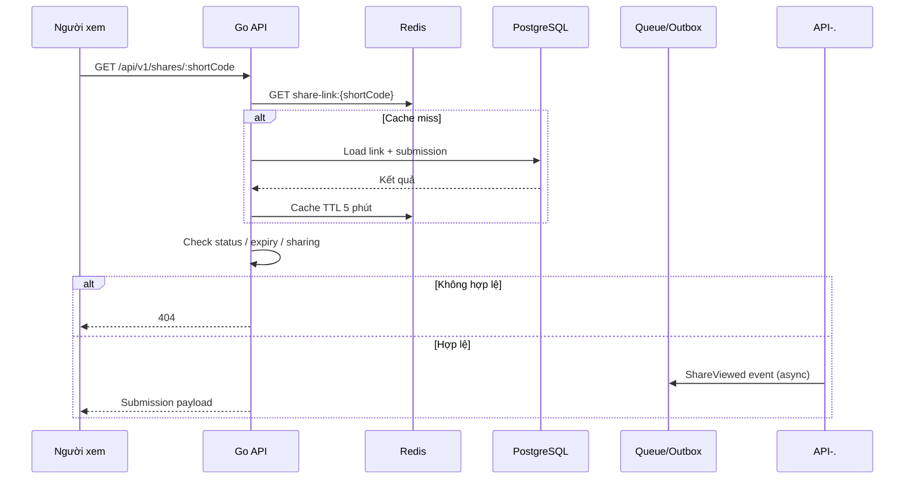
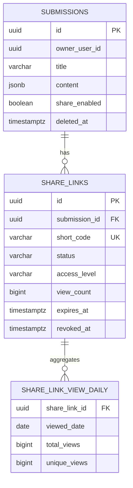

# Shortbit

Shortbit là dịch vụ URL shortener dành cho tính năng chia sẻ bài làm của YouPass. Mục tiêu là cung cấp link ngắn dạng `https://youpass.vn/s/:id`, phản hồi nhanh, có thể vô hiệu hóa ngay khi học sinh tắt chia sẻ, và ghi nhận lượt xem mà không làm chậm request đọc.

## Phạm vi bản khởi tạo

Repository này mới là backend foundation để review kiến trúc trước khi triển khai đầy đủ. Đã có:

- HTTP API Gin với endpoint health check và resolve link public.
- Domain model, PostgreSQL migration và repository cho `Submission` / `ShareLink`.
- Redis read-through cache; Redis lỗi không làm link hợp lệ bị lỗi.
- Kiểm tra link revoked, hết hạn, bài làm bị xóa và cờ `share_enabled`.
- Sinh short code URL-safe bằng `crypto/rand`.
- Ranh giới service sẵn sàng thay phần ghi view trực tiếp bằng event/outbox worker.

MVP đã có ownership qua `X-User-ID`, create/update/revoke link API và in-process async view worker. Chưa triển khai: tích hợp identity/JWT thực tế, transactional outbox có độ bền liên tiến trình, rate limiting, migration runner, unique-view analytics và frontend React.

## Kiến trúc



`share_links` là thực thể đại diện cho quyền chia sẻ, tách khỏi bài làm. Một request resolve chỉ thành công khi link `active`, chưa bị revoke, chưa hết hạn; đồng thời bài làm chưa bị xóa và `share_enabled = true`.

## Flow resolve URL



API dùng `404` cả khi link không tồn tại lẫn khi đã bị vô hiệu nhằm hạn chế dò link. Khi người sở hữu revoke link hoặc tắt share, transaction cập nhật DB phải xóa cache key `share-link:{shortCode}` ngay sau commit.

## Database schema



| Bảng | Vai trò |
|---|---|
| `submissions` | Bài làm và cờ chia sẻ tổng ở cấp bài làm. |
| `share_links` | Mapping mã ngắn sang bài làm, trạng thái vòng đời, quyền truy cập và counter tổng hợp. |
| `share_link_view_daily` | Thống kê lượt xem theo ngày, phù hợp cho dashboard. |

Khi cần analytics/audit chi tiết, sẽ bổ sung `share_link_view_events` có partition theo thời gian hoặc đưa event sang kho analytics. Không ghi event đồng bộ trên đường hot path.

## Định hướng về performance và bảo mật

- `short_code` có unique index; lookup là truy vấn điểm.
- Mã link không tuần tự, tối thiểu 72-bit entropy trong implementation hiện tại.
- Redis cache TTL ngắn, invalidation chủ động khi revoke/thay đổi quyền.
- View sẽ được ghi qua transactional outbox hoặc queue, worker batch increment `view_count` và upsert aggregate theo ngày.
- Endpoint public sẽ có IP-based rate limit và bot policy trước khi production.
- `access_level` đã có trong schema: `public`, `authenticated`, `restricted`; enforcement chi tiết sẽ được thêm cùng module identity của YouPass.

## Cấu trúc code

```text
cmd/api/                       entry point HTTP server
internal/config/               biến môi trường
internal/platform/             PostgreSQL và Redis adapters
internal/share/domain/         domain entities và business invariant
internal/share/repository/     persistence adapter
internal/share/service/        use case resolve link
internal/share/transport/http/ Gin router + handler
migrations/                    PostgreSQL DDL
```

Structure tham chiếu cách tổ chức từ `go-base-project`; dependency local `go-base-utils` được khai báo qua `replace` để có thể dùng các helper như HTTP middleware, rate limit, cache, logging, transaction/outbox khi bước implementation bắt đầu.

## Chạy local

Yêu cầu: Go 1.22.7+, PostgreSQL và Redis.

```bash
make run-local
```

Lệnh này tương đương `go run main.go start --config=./config/local/config.yaml`. Theo convention Courier, có thể chọn config khác bằng `APP_ENV=dev make run-local` hoặc truyền `--config` trực tiếp.

Sau đó kiểm tra:

```bash
curl -i http://localhost:8080/healthz
```

## API MVP

```http
GET    /healthz
POST   /api/v1/submissions
PATCH  /api/v1/submissions/:submissionID/sharing
POST   /api/v1/submissions/:submissionID/share-links
PATCH  /api/v1/share-links/:shareLinkID
DELETE /api/v1/share-links/:shareLinkID
GET    /api/v1/share-links/:shareLinkID/analytics?from=YYYY-MM-DD&to=YYYY-MM-DD
GET    /api/v1/shares/:shortCode
```

Các API quản trị yêu cầu header sau trong MVP:

```http
X-User-ID: <UUID>
```

Header này là adapter tạm thời để test bằng Postman. Khi tích hợp YouPass identity service, middleware sẽ thay bằng JWT/session claims nhưng use case ownership không thay đổi.

Ví dụ luồng Postman:

```http
POST /api/v1/submissions
X-User-ID: 11111111-1111-1111-1111-111111111111
Content-Type: application/json

{"title":"Bài kiểm tra Toán","content":{"score":10},"shareEnabled":true}
```

Sau đó dùng `id` trả về để gọi `POST /submissions/:submissionID/share-links`.

`GET /shares/:shortCode` không yêu cầu đăng nhập với link `public`; link `authenticated` yêu cầu `X-User-ID`. `restricted` được schema hỗ trợ nhưng MVP từ chối resolve cho đến khi có bảng/mapping nhóm người dùng.

## Test API bằng cURL / Postman

Khởi động service:

```bash
make run-local
```

Khai báo biến dùng chung. Postman có thể import trực tiếp từng lệnh cURL bên dưới.

```bash
export BASE_URL="http://localhost:8080"
export USER_ID="11111111-1111-1111-1111-111111111111"
```

### 1. Tạo bài làm

```bash
curl --request POST "$BASE_URL/api/v1/submissions" \
  --header "Content-Type: application/json" \
  --header "X-User-ID: $USER_ID" \
  --data '{
    "title": "Bài kiểm tra Toán",
    "content": {"score": 10, "answers": [{"question": 1, "answer": "A"}]},
    "shareEnabled": true
  }'
```

Lưu `id` trả về vào `SUBMISSION_ID`.

### 2. Bật hoặc tắt chia sẻ của bài làm

```bash
curl --request PATCH "$BASE_URL/api/v1/submissions/$SUBMISSION_ID/sharing" \
  --header "Content-Type: application/json" \
  --header "X-User-ID: $USER_ID" \
  --data '{"enabled": false}'
```

Khi tắt, cache của mọi link thuộc bài làm được invalidated; public resolve trả `404` ngay sau đó.

### 3. Tạo link chia sẻ public

```bash
curl --request POST "$BASE_URL/api/v1/submissions/$SUBMISSION_ID/share-links" \
  --header "Content-Type: application/json" \
  --header "X-User-ID: $USER_ID" \
  --data '{"accessLevel": "public"}'
```

Lưu `id` và `shortCode` trả về vào `SHARE_LINK_ID`, `SHORT_CODE`.

### 4. Tạo link có thời hạn hoặc yêu cầu đăng nhập

```bash
curl --request POST "$BASE_URL/api/v1/submissions/$SUBMISSION_ID/share-links" \
  --header "Content-Type: application/json" \
  --header "X-User-ID: $USER_ID" \
  --data '{
    "accessLevel": "authenticated",
    "expiresAt": "2026-12-31T23:59:59Z"
  }'
```

### 5. Cập nhật link

```bash
curl --request PATCH "$BASE_URL/api/v1/share-links/$SHARE_LINK_ID" \
  --header "Content-Type: application/json" \
  --header "X-User-ID: $USER_ID" \
  --data '{
    "accessLevel": "authenticated",
    "expiresAt": "2026-12-31T23:59:59Z"
  }'
```

### 6. Resolve link public

```bash
curl --request GET "$BASE_URL/api/v1/shares/$SHORT_CODE"
```

Với link `authenticated`, thêm header sau:

```bash
curl --request GET "$BASE_URL/api/v1/shares/$SHORT_CODE" \
  --header "X-User-ID: $USER_ID"
```

### 7. Xem analytics

```bash
curl --request GET "$BASE_URL/api/v1/share-links/$SHARE_LINK_ID/analytics" \
  --header "X-User-ID: $USER_ID"
```

Hoặc giới hạn ngày:

```bash
curl --request GET "$BASE_URL/api/v1/share-links/$SHARE_LINK_ID/analytics?from=2026-10-01&to=2026-10-31" \
  --header "X-User-ID: $USER_ID"
```

### 8. Revoke link

```bash
curl --request DELETE "$BASE_URL/api/v1/share-links/$SHARE_LINK_ID" \
  --header "X-User-ID: $USER_ID"
```

### 9. Health check

```bash
curl --request GET "$BASE_URL/healthz"
```

## Clean architecture

```text
domain/        entities, invariants, repository/cache ports
application/   use cases: submission, share link, view worker
repository/    PostgreSQL implementation của repository ports
transport/http Gin handlers, request validation, HTTP mapping, temporary identity adapter
platform/      Redis/PostgreSQL low-level adapters
```

Dependency luôn hướng vào trong: HTTP và PostgreSQL phụ thuộc use case/domain, còn domain không phụ thuộc Gin, GORM hay Redis.

MVP dùng convention khởi tạo của Courier: `main.go → startup → internal.InitializeContainer`. Dependencies được nối trong `internal/wire.go` và output được generate tại `internal/wire_gen.go`. Chạy `make wire` sau khi thay đổi constructor/dependency graph.

## Kế hoạch implementation tiếp theo

1. Chốt contract với YouPass identity/submission service, cách lấy ownership và payload bài làm.
2. Thêm create/revoke API, authorization middleware và Redis invalidation sau commit.
3. Thêm transactional outbox + worker ghi view theo batch, rồi dashboard analytics.
4. Thêm test repository/service, observability, rate limit và React share page.
